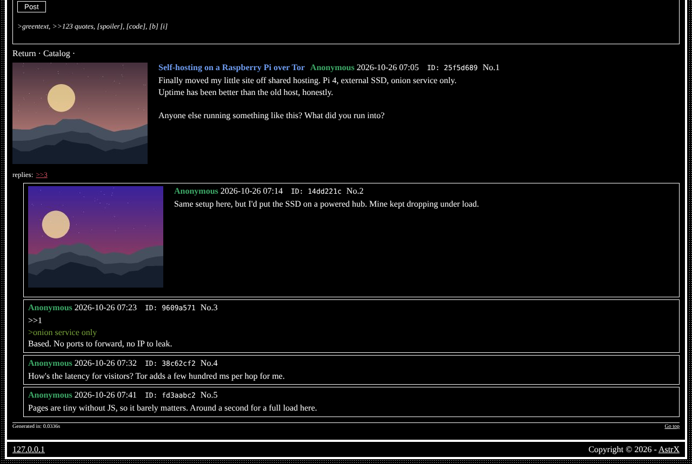

# astrx/module-imageboard

Imageboard: boards, threads, image posts, moderation and feeds — the **Imageboard** module of [AstrX](https://github.com/Vxmdzhb/astrx).



- Module key: `imageboard` (switch it on in the site's `resources/config/Modules.config.php`)
- Pages: `admin_boards`, `admin_config_imageboard`, `board`, `board_feed`, `board_file`, `board_mod`, `board_overboard`, `board_search`
- Requires: `astrx/cms`, `astrx/framework`, `astrx/library`

It ships its own templates, catalogs (en, it), default configuration and SQL in
`resources/`; the site overrides any of them from its own `resources/`.

AstrX isn't on Packagist and doesn't tag versions: you install from each
repository's `main`, and your `composer.lock` pins the exact commit. Tell
Composer where to find the package and the AstrX packages it depends on:

```json
{
    "minimum-stability": "dev",
    "prefer-stable": true,
    "repositories": [
        { "type": "vcs", "url": "https://github.com/Vxmdzhb/module-imageboard" },
        { "type": "vcs", "url": "https://github.com/Vxmdzhb/cms" },
        { "type": "vcs", "url": "https://github.com/Vxmdzhb/framework" },
        { "type": "vcs", "url": "https://github.com/Vxmdzhb/library" }
    ]
}
```

Then:

```sh
composer require astrx/module-imageboard:dev-main
```

After that, list `AstrX\Imageboard\ImageboardModule::class` in the
site's `ApplicationModules::INSTALLED` and run the installer to create its
tables. See [modules](https://github.com/Vxmdzhb/astrx/blob/main/docs/MODULES.md).

Issues and pull requests are welcome here. [AstrX](https://github.com/Vxmdzhb/astrx)
is the site that puts all the packages together.
